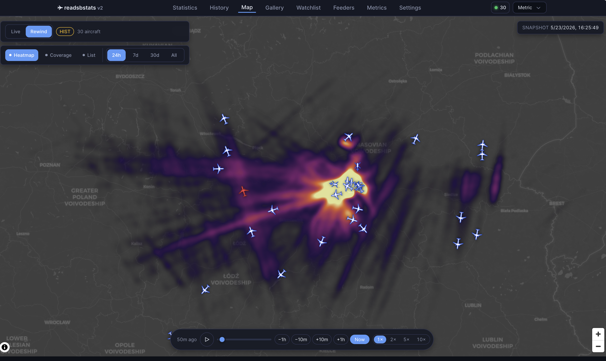
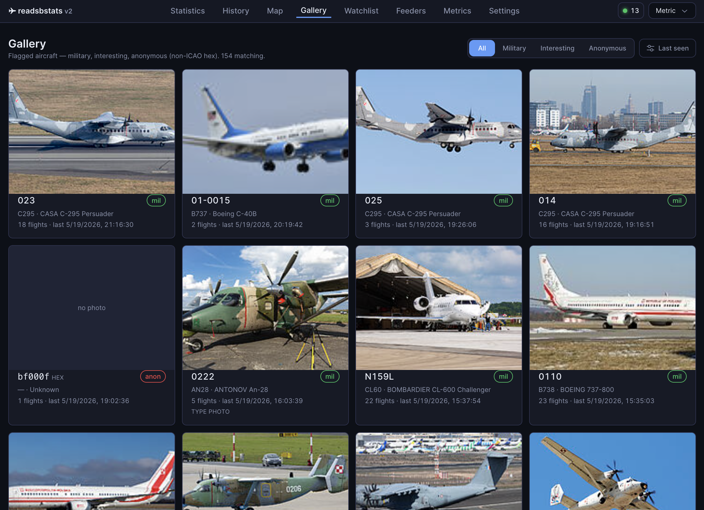
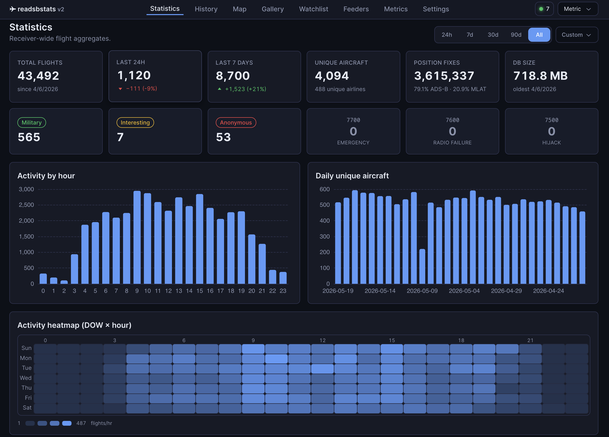
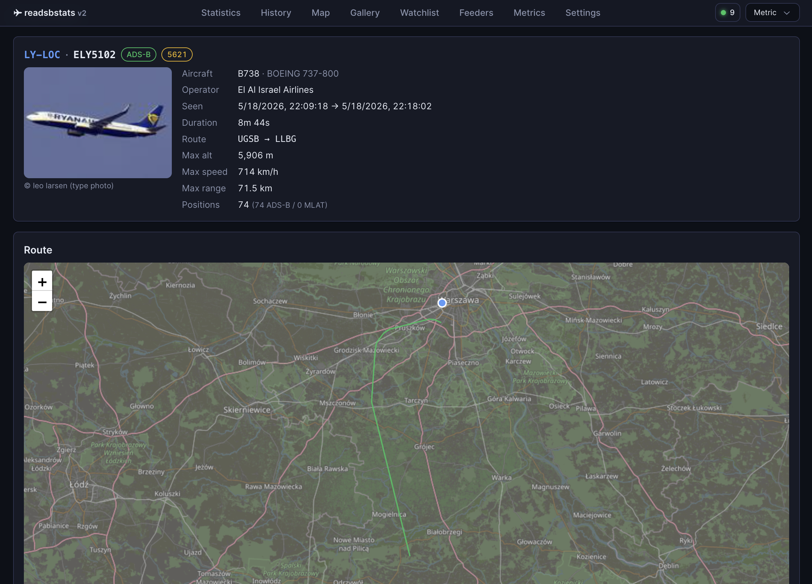
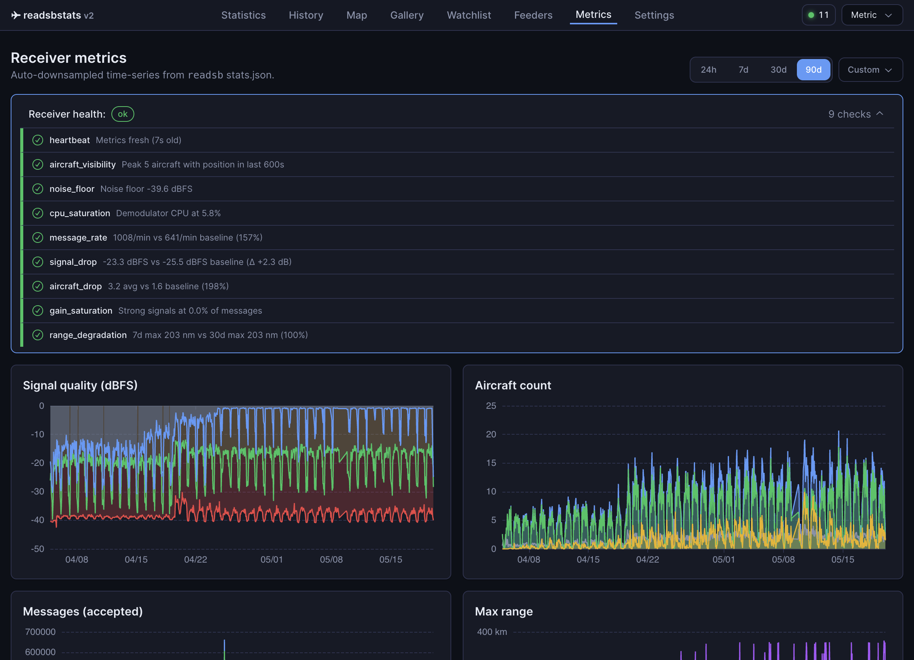
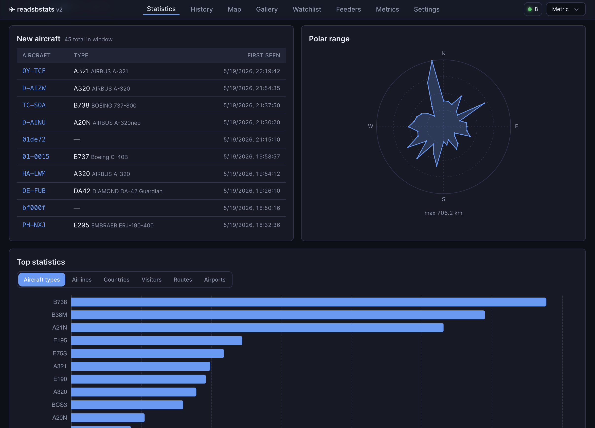

# readsbstats

[](https://github.com/blindp3w/readsbstats/actions/workflows/test.yml)
[](https://github.com/blindp3w/readsbstats/releases/latest)
[](LICENSE)

Extended flight history and track logging for [readsb](https://github.com/wiedehopf/readsb) ADS-B receivers, with a web UI for browsing historical flights and statistics.

Designed to run alongside readsb, tar1090, and feed clients on a **Raspberry Pi 4** without overwhelming it.

readsb and tar1090 give you a great live view — readsbstats adds the other half: a persistent SQLite history of every flight, a full-featured browser UI for exploring it, Telegram notifications for military and watchlist aircraft, and a receiver health dashboard backed by months of metrics.

> 🤖 **About this project:** readsbstats was entirely vibecoded with [Claude Code](https://claude.com/claude-code). Every line of code, test, and configuration in this repository was generated by AI under the maintainer's direction — not a single line was written by hand.

## Contents

- [Screenshots](#screenshots)
- [Features](#features)
- [Requirements](#requirements)
- [Installation](#installation)
- [Security model](#security-model)
- [Resource usage](#resource-usage)
- [Project structure](#project-structure)
- [Documentation](#documentation)
- [Contributing](#contributing)
- [License](#license)

## Screenshots

| | |
|---|---|
|  |  |
| Live map — Live / Rewind / HIST modes, bottom command bar, position heatmap, coverage overlay | Gallery — military, interesting, and anonymous (non-ICAO hex) aircraft with photos |
|  |  |
| Statistics — summary tiles, hourly activity chart, DOW×hour heatmap, top-N datasets | Flight detail — photo, route, altitude/speed chart, full position log |
|  |  |
| Metrics — 9 health checks (baseline-aware) above 10 time-series charts (ECharts, LTTB) | Statistics — polar coverage range plot and top aircraft types, airlines, routes |

## Features

- Collects aircraft positions every 5 seconds from readsb's `aircraft.json`
- Groups positions into flights (30-minute silence gap = new flight); tracks ADS-B vs MLAT per position
- Stores everything in SQLite — no extra database server
- Aircraft enrichment: registration, type, operator from [tar1090-db](https://github.com/wiedehopf/tar1090-db) (~620k aircraft)
- Aircraft photos: Planespotters.net → airport-data.com → hexdb.io → Wikipedia type fallback; cached 30 days
- Military, interesting & anonymous (non-ICAO hex) aircraft detection, badges, and gallery
- Route enrichment via [adsbdb.com](https://www.adsbdb.com/) — origin/destination airport per flight
- Live map with **Live / Rewind / HIST** modes — rewind from "now" or jump to any moment within `map_history_hours` via a date+time picker; bottom command bar with playback scrubber, range pills, position heatmap, and coverage range overlay; responsive down to iPhone
- Telegram notifications for military/interesting/anonymous/watchlist/emergency-squawk events; interactive bot commands
- Aircraft watchlist — track by ICAO hex, registration, or callsign prefix
- Receiver metrics dashboard with 10 time-series charts (Apache ECharts canvas, cross-panel hover sync, wheel/pinch zoom, LTTB downsampling) and 9 health checks
- Statistics dashboard — receiver-wide aggregates (top aircraft/airlines/routes/airports, hourly & daily activity, DOW×hour heatmap, polar coverage range). Defaults to the **last 7 days** for fast loads; the all-time view is background-warmed so it stays snappy
- Heatmap and coverage overlays served from collector-maintained daily rollup tables — millisecond responses at any history size, and the all-time views survive raw-position retention
- Optional **VDL2 / ACARS** integration (frozen at 2.29.0, still supported as-is: [ADR-0021](docs/decisions/0021-vdl2-frozen.md)) — ingest VHF Data Link Mode 2 traffic from a separate SDR via [dumpvdl2](https://github.com/szpajder/dumpvdl2) (recommended) or, with reduced functionality, [vdlm2dec](https://github.com/TLeconte/vdlm2dec): a Messages tab (live feed, filters, full-text search, human-readable label names) plus an ACARS panel on flight pages with OOOI block times (Out/Off/On/In from Q-series reports), route confirmation, and the route the aircraft reports in its ATN logon, a "has ACARS" badge/filter in history, and a Stats card. Fully pluggable (`RSBS_VDL2_ENABLED`), stored in its own database (see [Operations](docs/operations.md#vdl2--acars-ingest))
  - Human-readable decoded ACARS message bodies in the Messages log (client-side [`@airframes/acars-decoder`](https://github.com/airframes/acars-decoder), lazy-loaded; raw body always retained as fallback)
  - Extra local decoders for media advisories, D-ATIS and weather requests, Ryanair door events (marked "probable"), and Air France / KLM ETA and route reports; earlier blocks of multi-block messages are hidden by default (a "Show partial blocks" toggle reveals them)
  - Precise positions on the map overlay from `#M1BPOS`, Label-16 AUTPOS and the label-16-style group (labels 10, 13, 18, 27, 33, 12, 43, 41, 2P), LOT `59,G` telemetry, other airline formats (labels 17, 38, 2F, 14, B0) and ADS-C reports, each validated against ADS-B tracks ([ADR-0019](docs/decisions/0019-vdl2-position-and-route-sources.md)); coarse VDL2 XID link-layer fixes as a fallback; filed routes (departure/arrival/company route/SID/STAR/approach) surfaced on the message log
  - Flight-page route sources, in precedence order: the route the aircraft reports in its ATN Context-Management logon (needs dumpvdl2), Air France label-26 and KLM label-20 `RST` reports, then label-49 movement reports ([ADR-0019](docs/decisions/0019-vdl2-position-and-route-sources.md), [ADR-0020](docs/decisions/0020-vdl2-multiblock-fragments-and-local-decoders.md))
  - Each message row is tagged with a category chip (ACMS / engine / maintenance / route / …) so the H1-dominated feed is readable at a glance; `RTE` route messages also surface their filed departure→arrival
  - Selectable decoder (`RSBS_VDL2_DECODER`): **`dumpvdl2` is the recommended, fully supported decoder** — it also decodes ATN **CPDLC** controller–pilot messages and CM logons, H1 sublabel/MFI and ADS-C positions, and reports per-frame signal level, surfaced as per-channel **signal (dBFS)** and **SNR (dB)** charts on the Metrics page. `vdlm2dec` is a limited legacy option (ACARS only: no signal level/SNR, no sublabel/MFI handling, no CPDLC, no CM logon routes, no ADS-C positions; the Metrics charts self-hide on its feed). `dumpvdl2` is the code default; for `vdlm2dec` set `RSBS_VDL2_DECODER=vdlm2dec`
- Unit switching: Aeronautical / Metric / Imperial — persisted in browser
- SQLite crash-safety (WAL + `synchronous=NORMAL`, `RSBS_DB_SYNCHRONOUS=FULL` for per-commit durability) with dirty-shutdown detection (fail-closed on corruption — see [Operations](docs/operations.md#database-integrity--startup-recovery)) and weekly/monthly integrity checks via systemd timers

## Requirements

- Raspberry Pi 4 (or any Linux machine) running Ubuntu 22.04 / 24.04
- [readsb by wiedehopf](https://github.com/wiedehopf/readsb) writing JSON to `/run/readsb/`
- Python 3.10+
- nginx (for the `/stats/` reverse proxy)

## Installation

```bash
# 1. Sync source to the Pi (from your Mac/PC)
rsync -avz --delete \
  --exclude='.git' --exclude='__pycache__' --exclude='*.pyc' \
  --exclude='.venv' --exclude='*.egg-info' \
  --exclude='docs' --exclude='db' --exclude='.DS_Store' \
  --exclude='*.db' --exclude='*.db-wal' --exclude='*.db-shm' \
  --exclude='frontend/node_modules' --exclude='frontend/.vite' --exclude='frontend/coverage' \
  --exclude='internal_docs' --exclude='.claude' --exclude='CLAUDE.md' \
  /path/to/readsbstats/ pi@your-pi:/tmp/readsbstats/

# 2. SSH into the Pi and run the installer as root
ssh pi@your-pi
sudo bash /tmp/readsbstats/scripts/install.sh
```

The installer creates a `readsbstats` system user, sets up `/opt/readsbstats/` with a Python virtualenv, creates the SQLite database, and installs systemd services.

After installation, set your receiver coordinates in the single settings file, `/etc/readsbstats/readsbstats.env` (read by `readsbstats-collector`, `readsbstats-web` and `notify-telegram@`). The installer creates it from `systemd/readsbstats.env.example` (mode 0600, root:root) with every option commented out:

```ini
RSBS_LAT=YOUR_LATITUDE
RSBS_LON=YOUR_LONGITUDE
```

Then restart the services (`sudo systemctl restart readsbstats-collector readsbstats-web`) and open **`http://YOUR_PI_IP/stats/`**. A `systemctl edit` drop-in with `Environment=` lines also works, but a value in the env file overrides the same variable set in a drop-in. See [Configuration](docs/configuration.md) for all settings.

**Map basemap key.** The maps use CARTO Dark Matter tiles, which now require a
free API key — without one they render as "API KEY REQUIRED" placeholders. Get a
key at <https://carto.com/basemaps/apikey/> and add it to the same file, then
restart `readsbstats-web`:

```ini
RSBS_CARTO_API_KEY=YOUR_CARTO_KEY
```

The key is sent with every tile request, so it is visible to anyone who can
open the map — that is how CARTO keys are designed to be used. It is kept out
of the repo and the built bundle; the Settings page only shows whether it is set.

### nginx setup

The included conf rate-limits the API with `limit_req zone=rsbs_api`, so first declare the zone once in the `http {}` block of `nginx.conf` (not inside `server {}`) — `nginx -t` fails without it:

```nginx
limit_req_zone $binary_remote_addr zone=rsbs_api:1m rate=10r/s;
```

Then add one line to your nginx `server {}` block:

```nginx
server {
    include /opt/readsbstats/nginx-readsbstats.conf;
}
```

Test and reload with `sudo nginx -t && sudo systemctl reload nginx`. The conf file proxies `/stats/` to uvicorn at `127.0.0.1:8080` and serves the SPA's hashed asset bundles directly with long-cache headers.

## Security model

readsbstats has **no built-in authentication or authorization by default**. It is designed to run bound to `127.0.0.1:8080` behind nginx on a **trusted LAN**. Anyone who can reach the web port can read all flight data and call every mutating endpoint (watchlist add/delete).

- **The `X-Requested-With` CSRF header is not authentication.** It only blocks cross-site form posts from a browser; it does not identify or authorize a caller. Do not treat it as an access control.
- **If you expose the UI beyond a trusted LAN, put an authenticating reverse proxy in front** (HTTP basic auth, an OAuth2 proxy, or a VPN/Tailscale). Do not publish `127.0.0.1:8080` directly to the internet.
- **`RSBS_API_TOKEN`** — opt-in bearer-token gate for every mutating (POST/DELETE) `/api/*` endpoint (currently the watchlist add/delete). When set, every such call must carry `Authorization: Bearer <token>`. When unset (the default), the web server logs a one-line startup warning so the open posture is never silent. Read endpoints stay open (they were already public on the trusted LAN). Useful as a thin extra layer if the app is reachable from devices you don't fully trust on the LAN; **not** a substitute for a reverse-proxy auth layer when exposed to the internet.
- Outbound HTTP (photo/route enrichment) is SSRF-guarded (`http_safe.py`) and provider photo URLs are host-allowlisted before caching (`RSBS_PHOTO_HOST_ENFORCE`) and at the API response boundary.

See [Operations → Deployment security](docs/operations.md#deployment-security) for the full trust model.

## Resource usage

| Service | CPU quota | Memory limit |
|---|---|---|
| collector | 15% | 192 MB |
| web server | 50% | 1024 MB |

Database size (schema v6, traffic-dependent): on a busy receiver, `history.db` plateaus at about 1.8 GB with 180-day position retention (`RSBS_RETENTION_DAYS=180`; recommended) — measured 1.82 GB for 20.5 M position rows and 228 k flights, roughly 89 bytes per position row including indexes. Before the plateau it grows by about 300 MB/month on that receiver; without retention it keeps growing at the same rate.

## Project structure

```
readsbstats/
├── src/readsbstats/            # Python package
│   ├── collector.py            # Polling daemon, flight detection, writes
│   ├── web.py                  # FastAPI app factory + lifespan + SPA-shell routes
│   ├── cache.py                # Response cache + map-cache prewarmer thread
│   ├── api/                    # Per-domain APIRouter modules
│   │   ├── _deps.py            # DB connection seam, shared SQL/allowlists, _csrf_check
│   │   ├── _photos.py          # Photo-fetch ladder + per-type async locks
│   │   ├── flights.py          # /api/flights*, /api/flights/{id}/*
│   │   ├── aircraft.py         # /api/aircraft/*, /api/airlines/*, /api/types/*
│   │   ├── stats.py            # /api/stats, /api/stats/records, /api/stats/polar
│   │   ├── map.py              # /api/map/*, /api/live
│   │   ├── feeders.py          # /api/feeders + systemd/port checkers
│   │   ├── settings.py         # /api/settings + _settings_* helpers
│   │   ├── watchlist.py        # /api/watchlist GET/POST/DELETE
│   │   ├── airspace.py         # /api/airspace
│   │   ├── health.py           # /api/health, /api/metrics, /api/metrics/health
│   │   ├── dates.py            # /api/dates
│   │   └── vdl2.py             # /api/vdl2/* (opt-in; reads the separate vdl2.db)
│   ├── database.py             # SQLite schema, WAL, migrations
│   ├── config.py               # RSBS_* env vars
│   ├── schemas.py              # Pydantic response contracts for the hot /api/* endpoints
│   ├── cleaners.py             # Input normalization + lat/lon/ICAO validators
│   ├── http_safe.py            # SSRF-safe HTTP helpers (HTTPS-only)
│   ├── photo_sources.py        # Planespotters → airport-data → hexdb → Wikipedia
│   ├── enrichment.py           # In-process caches for aircraft/airline/override lookups
│   ├── adsbx_enricher.py       # airplanes.live area-poll enricher
│   ├── route_enricher.py       # Callsign → route via adsbdb.com
│   ├── db_updater.py           # Weekly aircraft/airline database refresh
│   ├── icao_ranges.py          # 24-bit Mode-S → country, anonymous-aircraft SQL
│   ├── metrics_collector.py    # Receiver metrics from readsb stats.json (opt-in)
│   ├── notifier.py             # Telegram notifications
│   ├── rollups.py              # Daily heatmap/coverage rollups (collector-maintained)
│   ├── posenc.py               # Scaled-integer codecs for positions columns (schema v6)
│   ├── downsample.py           # LTTB downsampling for chart endpoints
│   ├── health.py               # Receiver health checks
│   ├── geo.py                  # haversine_nm, bearing
│   ├── sim.py                  # Dev-only aircraft.json simulator
│   ├── vdl2_collector.py       # Opt-in VDL2/ACARS ingest service (UDP → vdl2.db)
│   └── vdl2/                   # VDL2/ACARS parsing + separate vdl2.db
│       ├── db.py               # vdl2.db schema + idempotent migrate()
│       ├── normalize.py        # vdlm2dec / dumpvdl2 JSON → one record
│       ├── atn.py              # ATN CPDLC intents + CM logon
│       ├── oooi.py             # OOOI block times + routes (Q-series, labels 49/26/20, CM)
│       ├── positions.py        # Precise positions via label → parser whitelist
│       ├── m1bpos.py           # #M1BPOS positions + filed routes
│       ├── rte.py              # Teledyne RTE filed routes
│       └── adsc.py             # ADS-C positions from dumpvdl2 raw JSON
├── scripts/
│   ├── install.sh              # First-time installer
│   ├── update.sh               # Code sync + restart + optional DB update
│   ├── backfill_vdl2_dumpvdl2.py # One-shot: backfill VDL2 rows after dumpvdl2-related upgrades
│   ├── migrate_v6.py           # One-shot offline migration: schema v5 → v6
│   ├── check_db.py             # SQLite integrity checker (also run by the systemd timers)
│   ├── import_rrd.py           # Import graphs1090 RRD history into receiver_stats
│   ├── purge_ghosts.py         # One-shot: remove ghost positions
│   ├── purge_bad_gs.py         # One-shot: null implausible gs values
│   └── purge_mlat_gs_spikes.py # One-shot: null MLAT gs spikes
├── frontend/                   # React 19 + Vite 8 SPA (610 Vitest tests)
├── tests/                      # pytest (2464 tests) + Playwright UI (84 tests)
├── static/airspace/            # Bundled airspace GeoJSON
├── systemd/                    # Service + timer unit files
└── docs/                       # Public documentation
    ├── configuration.md        # All RSBS_* environment variables
    ├── api.md                  # API endpoints + database schema
    ├── integrations.md         # Telegram setup + ghost/GS filtering
    ├── operations.md           # Updating, maintenance, useful commands
    ├── development.md          # Local dev, testing, build, deploy
    ├── dumpvdl2-airspy-mini.md # Running dumpvdl2 on an Airspy Mini
    ├── README.md               # Documentation index
    ├── decisions/              # Architecture Decision Records
    └── screenshots/            # UI screenshots
```

## Documentation

Full guides live in [`docs/`](docs/), grouped by reference / how-to / explanation:

| Guide | Contents |
|---|---|
| [Configuration](docs/configuration.md) | All 84 `RSBS_*` env vars, logging, airspace config |
| [API Reference](docs/api.md) | All API endpoints, SPA routes, database schema |
| [Integrations](docs/integrations.md) | Telegram setup, bot commands, ghost/GS filtering |
| [Operations](docs/operations.md) | Updating code, DB sync, useful commands, backups |
| [Development](docs/development.md) | Local setup, tests, build, deploy to Pi |
| [dumpvdl2 on an Airspy Mini](docs/dumpvdl2-airspy-mini.md) | Driving dumpvdl2 from an Airspy Mini via external IQ resampling |
| [Architecture decisions](docs/decisions/) | ADRs for key technical choices |

## Contributing

Bug reports and pull requests are welcome — see [CONTRIBUTING.md](CONTRIBUTING.md) for setup and style guidelines. This project follows the [Code of Conduct](CODE_OF_CONDUCT.md).

## License

MIT — see [`LICENSE`](LICENSE).

The bundled frontend (`frontend/dist/`) includes Apache ECharts (Apache-2.0)
and other open-source libraries. Required attribution lives in
[`THIRD_PARTY_NOTICES.md`](THIRD_PARTY_NOTICES.md).
